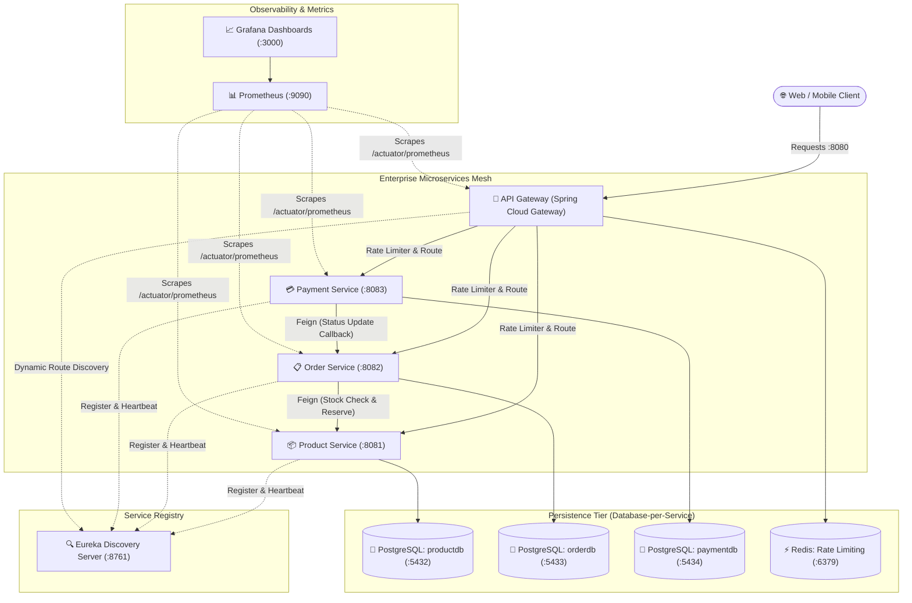

# 🛒 E-Commerce Microservices Platform

An enterprise-grade, cloud-native **E-Commerce Microservices Platform** built with **Java 17, Spring Boot 3, Spring Cloud 2023, Docker, Jenkins, and SonarQube**. Designed as a portfolio-grade reference architecture for modern software engineering and DevOps interviews.

---

## 🏛️ System Architecture



---

## 🚀 Microservices Breakdown

| Service | Port | Database | Primary Responsibility |
|---|---|---|---|
| **[api-gateway](file:///d:/Microservices/Microservices/api-gateway)** | `8080` | Redis (`6379`) | Unified reverse proxy, IP rate limiting, circuit breaker fallback, CORS, distributed tracing correlation IDs |
| **[discovery-server](file:///d:/Microservices/Microservices/discovery-server)** | `8761` | In-memory | Netflix Eureka registry for peer service lookup and dynamic load balancing |
| **[product-service](file:///d:/Microservices/Microservices/product-service)** | `8081` | PostgreSQL (`5432`) | Catalog CRUD, category filtering, stock reservation, and atomic inventory updates |
| **[order-service](file:///d:/Microservices/Microservices/order-service)** | `8082` | PostgreSQL (`5433`) | Order lifecycle management, Feign-based stock validation, compensating transaction on cancellation |
| **[payment-service](file:///d:/Microservices/Microservices/payment-service)** | `8083` | PostgreSQL (`5434`) | Transaction processing, payment gateway simulation, refunds, and order status notification |

---

## 🎯 Key Microservice Patterns Implemented

1. **Database-per-Service**: Each microservice strictly owns its dedicated PostgreSQL database schema, preventing tight coupling and guaranteeing loose coupling.
2. **API Gateway Pattern**: Single entry point on port `8080` routing to downstream services using service names (`lb://product-service`) resolved via Eureka.
3. **Circuit Breaker & Fallback (Resilience4j)**: Protects downstream dependencies from cascading failures. When a service trips, the gateway responds with graceful fallback messages.
4. **Distributed Tracing & Correlation ID**: Global reactive filter injects `X-Correlation-ID` into every HTTP request to trace requests across microservice boundaries.
5. **Rate Limiting**: Reactive Redis token-bucket rate limiter defending services against DDoS or burst traffic.
6. **Compensating Transactions (Saga Orchestration)**: If an order is cancelled or payment fails, reserved inventory in `product-service` is automatically released.

---

## 🔄 CI/CD & DevOps Architecture

### 1. Jenkins Declarative Pipeline (`Jenkinsfile`)

```mermaid
flowchart LR
    A[1. Checkout] --> B[2. Compile & JaCoCo Test]
    B --> C[3. SonarQube Analysis]
    C --> D[4. Quality Gate Check]
    D --> E[5. Package JARs]
    E --> F[6. Parallel Docker Build]
    F --> G[7. Trivy Security Scan]
    G --> H[8. Push to Registry]
    H --> I[9. Deploy via Compose]
    I --> J[10. Smoke Tests]
```



- **JaCoCo Test Coverage**: Automatically generated per-service reports (`**/target/site/jacoco/jacoco.xml`).
- **SonarQube Quality Gate**: Hard-stops the pipeline if code quality breaches thresholds (Bugs = 0, Vulnerabilities = 0, Coverage > 80%).
- **Multi-stage Docker Builds**: Uses `eclipse-temurin:17-jdk` for build caching and `eclipse-temurin:17-jre` with non-root security profiles for slim production images.
- **Trivy Container Scan**: Proactively catches CVEs in container base images before deployment.

### 2. SonarQube Static Code Analysis (`sonar-project.properties`)
- Code smell detection, security hotspot reviews, and automated test coverage ingestion.
- Configured at both Maven parent module level and standalone scanner property level.

---

## ⚡ Quick Start: Running with Docker Compose

### Prerequisites
- Docker Engine 24+ & Docker Compose v2+
- (Optional for manual build) JDK 17 & Maven 3.9+

### Start the Entire Stack
From the project root directory:

```bash
docker compose up -d --build
```

### Verify Service Health
Check that all 13 containers are running:

```bash
docker compose ps
```

| Component | URL | Credentials |
|---|---|---|
| **Eureka Dashboard** | `http://localhost:8761` | None |
| **API Gateway** | `http://localhost:8080` | None |
| **SonarQube Dashboard** | `http://localhost:9000` | `admin` / `admin` (update on first login) |
| **Prometheus** | `http://localhost:9090` | None |
| **Grafana** | `http://localhost:3000` | `admin` / `admin` |

---

## 🧪 End-to-End API Walkthrough (Via API Gateway)

### 1. Create a Product
```bash
curl -X POST http://localhost:8080/api/products \
  -H "Content-Type: application/json" \
  -d '{
    "name": "Sony WH-1000XM5 Headphones",
    "description": "Industry-leading noise cancelling wireless headphones",
    "price": 399.99,
    "stockQuantity": 100,
    "category": "Electronics",
    "sku": "SONY-WH1000XM5-BLK"
  }'
```

### 2. Query Available Products
```bash
curl -X GET http://localhost:8080/api/products
```

### 3. Place a New Customer Order
```bash
curl -X POST http://localhost:8080/api/orders \
  -H "Content-Type: application/json" \
  -d '{
    "customerId": 1001,
    "shippingAddress": "742 Evergreen Terrace, Springfield",
    "notes": "Leave at front porch",
    "items": [
      {
        "productId": 1,
        "quantity": 2
      }
    ]
  }'
```
*(Notice: Order status becomes `CONFIRMED` and `product-service` stock quantity decrements from 100 to 98)*.

### 4. Process Payment for Order
```bash
curl -X POST http://localhost:8080/api/payments \
  -H "Content-Type: application/json" \
  -d '{
    "orderId": 1,
    "customerId": 1001,
    "amount": 799.98,
    "paymentMethod": "CREDIT_CARD",
    "cardNumber": "4532111122223333",
    "cvv": "123",
    "expiryDate": "12/28"
  }'
```
*(Notice: Payment succeeds with `SUCCESS` status and automatically invokes `order-service` via Feign to update status to `PAID`)*.

### 5. Check Final Order Status
```bash
curl -X GET http://localhost:8080/api/orders/1
```

---

## 🎤 Interview Cheatsheet: High-Yield Discussion Topics

1. **Why Eureka over Kubernetes native DNS?**
   - In Spring Cloud, Eureka provides client-side load balancing via Spring Cloud LoadBalancer/Ribbon without requiring Kubernetes Ingress controllers. For hybrid cloud or non-K8s environments, Eureka offers full programmatic control over routing and instance health metadata.
2. **How does Circuit Breaking work with Resilience4j?**
   - Uses a sliding window (count or time-based) monitoring failure percentage. When failures exceed `50%`, circuit switches to `OPEN` and fast-fails requests to the fallback method. After `waitDurationInOpenState` (5s), it transitions to `HALF_OPEN` testing canary calls before fully closing.
3. **How do you handle Distributed Transactions without 2PC?**
   - 2-Phase Commit (XA transactions) creates severe lock contention in microservices. Instead, we use the **Saga Pattern** with compensating actions: when an order is cancelled or a downstream step fails, a compensating endpoint (`/api/products/{id}/release`) reverses the stock deduction.
4. **Why JaCoCo + SonarQube in Jenkins?**
   - JaCoCo measures test execution coverage during Maven build. SonarQube ingests `jacoco.xml` along with AST analysis to inspect cyclomatic complexity, code duplication, and security vulnerabilities (OWASP Top 10), enforcing hard Quality Gates before Docker containerization.
